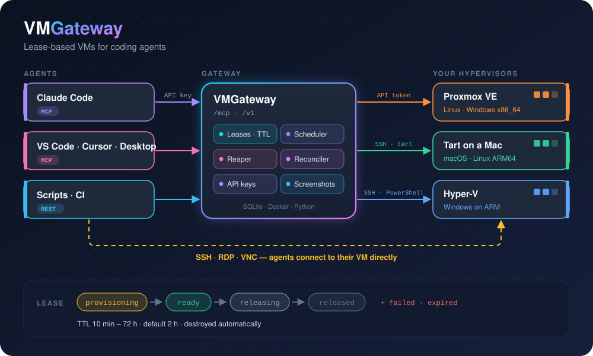

# VMGateway

[繁體中文](README.md) | **English**

On-demand VMs of any operating system for coding agents.

VMGateway is a lease-based service that wraps Proxmox VE, Tart and Hyper-V in a single MCP / REST API. An agent picks an OS, a size and how long it needs the machine; the gateway clones a VM from a template, sets up credentials and returns the IP. When the lease expires, the VM is destroyed.

<p align="center">
  
</p>

## Why

- **Cross-platform testing**: code written by agents has to run, be screenshotted and be verified on real Windows, macOS and Linux.
- **No hypervisor credentials for agents**: an agent only gets an API key; it never sees hypervisor IPs, passwords or tokens.
- **Always cleaned up**: every VM has a TTL and is destroyed when it expires; orphans left behind by a gateway crash are removed too.
- **Shared by a team**: one key per person with a per-user quota; deploy once and everyone can use it.

## Architecture

What happens on one `create_vm` call:

1. **Schedule**: find hosts that can serve the template and pick the node with the most free memory (honoring `max_vms` and Apple's limit of two running macOS VMs).
2. **Clone**: create `vmgw-xxxxxxxx` from the template (PVE linked clone, Tart APFS clone, Hyper-V differencing disk).
3. **Credentials**: cloud-init (Linux), unattend.xml (Windows) or the template's built-in account; users can also choose their own.
4. **Wait until ready**: get the IP and confirm the SSH / RDP / VNC ports accept connections, then return the IP, credentials and connect commands.
5. **Use**: the agent connects to the VM directly over SSH / RDP / VNC; that traffic does not go through the gateway.
6. **Reclaim**: on `destroy_vm` or expiry, delete the VM along with its disks, port forwarding and firewall rules.

| Component | Description |
|---|---|
| API | FastAPI; REST at `/v1`, MCP (Streamable HTTP) at `/mcp`, both using the same API keys |
| Lease manager | Lease state machine: `provisioning → ready → releasing → released`, plus `failed` and `expired` |
| Reaper / Reconciler | Reclaims expired VMs every minute; every 10 minutes deletes `vmgw-*` VMs that have no lease |
| Backends | `proxmox` (REST API token), `tart` (SSH), `hyperv` (SSH + PowerShell) |
| Store | SQLite holding users (keys stored hashed) and leases |

## Supported platforms

| Platform | Operating systems | Credentials | Time to ready (measured) |
|---|---|---|---|
| Proxmox VE | Linux, Windows (x86_64) | cloud-init / template account | Ubuntu ~19 s, Windows 11 ~25 s |
| Tart (Apple Silicon Mac) | macOS, Linux (ARM64) | template account | Ubuntu ~13 s, macOS ~26 s |
| Hyper-V | Windows on ARM | unattend.xml | ~3 min (includes OOBE) |

`screenshot_vm` works on every platform, even before anyone has logged in.

## Quick start

**1. Deploy the gateway**

```bash
git clone https://github.com/joshhu/VMGateway && cd VMGateway
cp config.example.yaml config.yaml   # your hosts and templates
cp .env.example .env                 # passwords and tokens
docker compose up -d --build
docker compose exec vmgateway vmgw user add alice --admin   # prints the API key (shown once)
```

Every environment is different; you can ask Claude Code to read `config.example.yaml` and generate your config. For what each platform needs beforehand, see [Preparing the hypervisors](docs/guide.md#準備虛擬化主機).

**2. Connect Claude Code**

```bash
claude mcp add --transport http --scope user vmgw http://<gateway>:8000/mcp \
  --header "Authorization: Bearer <api key>"
```

For VS Code, Cursor and Claude Desktop, see [Installing the MCP server](docs/guide.md#2-安裝-mcp).

**3. Just ask your agent**

> Spin up a Windows 11 ARM VM, open the Settings app and send me a screenshot, then delete the VM.

The agent calls `list_templates` → `create_vm` → `screenshot_vm` → `destroy_vm`.

## MCP tools

| Tool | Description |
|---|---|
| `list_templates` | Available OS templates |
| `list_hosts` | Hosts and free capacity |
| `create_vm(template, cpu?, memory_gb?, disk_gb?, ttl_minutes?, username?, password?)` | Create a VM; returns once it is reachable |
| `get_vm(lease_id)` | State, IP, credentials, connect commands |
| `list_vms` | Your current leases |
| `renew_vm(lease_id, ttl_minutes)` | Extend a lease |
| `screenshot_vm(lease_id)` | The VM's screen as a PNG |
| `destroy_vm(lease_id)` | Delete now |
| `create_api_key` / `list_api_keys` / `revoke_api_key` | Admin: issue and revoke keys; returns ready-to-paste client setup |

TTL defaults to 2 hours and ranges from 10 minutes to 72 hours.

## REST API

Every endpoint except `/healthz` requires `Authorization: Bearer <api key>`.

```bash
curl -H "Authorization: Bearer $KEY" -H 'Content-Type: application/json' \
  -d '{"template": "ubuntu-24.04", "ttl_minutes": 60, "wait": true}' \
  http://<gateway>:8000/v1/leases
```

| Method | Path | Description |
|---|---|---|
| GET | `/v1/templates` · `/v1/hosts` | Templates, host capacity |
| POST · GET | `/v1/leases` | Create · list leases |
| GET · DELETE | `/v1/leases/{id}` | Get · delete |
| POST | `/v1/leases/{id}/renew` | Renew |
| GET | `/v1/leases/{id}/screenshot` | Screenshot |
| POST · GET · DELETE | `/v1/users` | Admin: API key management |

Full parameters, response format and error codes are in the [guide](docs/guide.md#rest-api).

## Configuration

`config.yaml` holds structure only; secrets are always referenced through `*_env` fields that name environment variables in `.env`.

```yaml
hosts:
  - {name: pve, type: proxmox, url: https://pve.lan:8006, token_id: vmgw@pve!gateway, token_secret_env: PVE_TOKEN_SECRET}
templates:
  - id: ubuntu-24.04
    description: Ubuntu Server 24.04 LTS
    os: linux
    arch: amd64
    host_type: proxmox
    sources: [{host: pve, node: pve1, ref: "9024"}]
    defaults: {cpu: 2, memory_gb: 4, disk_gb: 20}
    credentials: {mode: cloudinit, username: agent}
    endpoints: [ssh]
```

See [`config.example.yaml`](config.example.yaml) for a full, commented example and the [configuration reference](docs/guide.md#設定檔說明) for every field. `scripts/pve/` has scripts that create the PVE token, the Ubuntu templates and the gateway VM.

## Documentation

[docs/guide.md](docs/guide.md) (Traditional Chinese): usage, preparing each platform, configuration fields, API key management, operations, error codes, troubleshooting and security notes.

## Development

```bash
uv sync
uv run pytest        # unit tests, no real hypervisors needed
uv run ruff check .
```

## License

[MIT](LICENSE)
