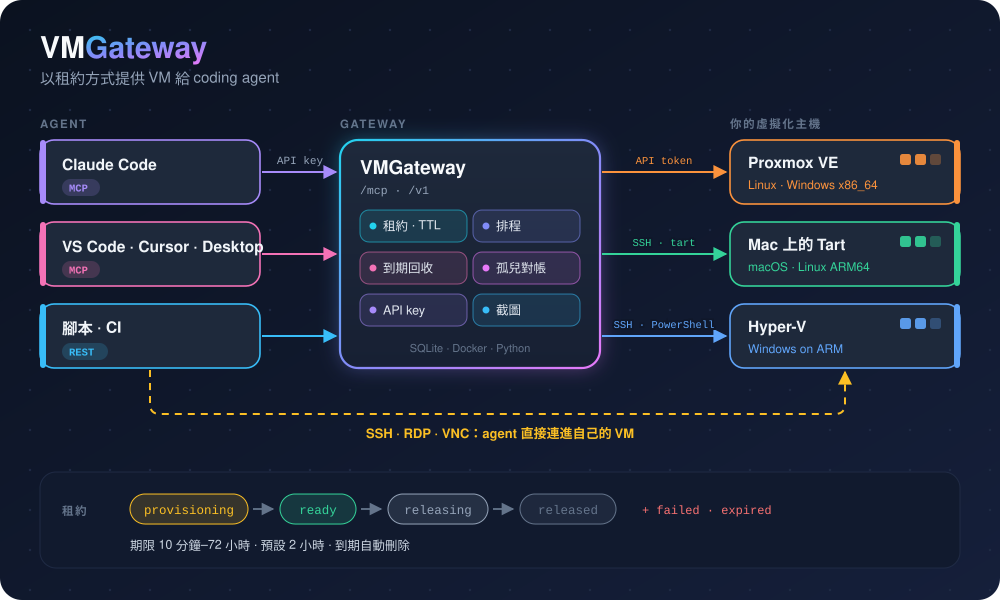

# VMGateway

**繁體中文** | [English](README.en.md)

讓 coding agent 隨需租用任何作業系統的 VM。

VMGateway 是一個以租約（lease）為核心的服務，把 Proxmox VE、Tart、Hyper-V 包成一套 MCP / REST API。Agent 指定作業系統、規格和使用時間，Gateway 從範本 clone 出 VM、設定帳密、回傳 IP；租約到期自動銷毀。

<p align="center">
  
</p>

## 為什麼

- **跨平台測試**：agent 寫的程式需要在真的 Windows、macOS、Linux 上跑、截圖、驗證。
- **不把主機帳密交給 agent**：agent 只拿一把 API key，看不到任何 hypervisor 的 IP、帳密或 token。
- **用完一定回收**：每台 VM 都有 TTL，到期自動刪除，Gateway 當機留下的孤兒 VM 也會被清掉。
- **多人共用**：每人一把 key、各自有數量上限，部署一次整個團隊都能用。

## 架構

一次 `create_vm` 的流程：

1. **排程**：依範本找出可用的主機，選剩餘記憶體最多的節點（遵守 `max_vms` 和 macOS 同時最多 2 台的限制）。
2. **Clone**：從範本建立 `vmgw-xxxxxxxx`（PVE linked clone、Tart APFS clone、Hyper-V differencing disk）。
3. **設定帳密**：cloud-init（Linux）、unattend.xml（Windows）或範本內建帳號，也可以由使用者指定。
4. **等待就緒**：拿到 IP 並確認 SSH / RDP / VNC 埠可連，才回傳 IP、帳密和連線指令。
5. **使用**：agent 直接用 SSH / RDP / VNC 連進 VM，流量不經過 Gateway。
6. **回收**：`destroy_vm` 或到期後，刪除 VM 與相關的磁碟、port forwarding、防火牆規則。

| 元件 | 說明 |
|---|---|
| API | FastAPI，REST 在 `/v1`，MCP（Streamable HTTP）在 `/mcp`，共用同一套 API key |
| Lease manager | 租約狀態機：`provisioning → ready → releasing → released`，失敗為 `failed`、到期為 `expired` |
| Reaper / Reconciler | 每分鐘回收到期 VM；每 10 分鐘對帳，刪除沒有租約的 `vmgw-*` VM |
| Backends | `proxmox`（REST API token）、`tart`（SSH）、`hyperv`（SSH + PowerShell） |
| Store | SQLite，存使用者（key 只存雜湊）與租約 |

## 支援平台

| 平台 | 作業系統 | 帳密設定 | 開機到可用（實測） |
|---|---|---|---|
| Proxmox VE | Linux、Windows（x86_64） | cloud-init / 範本帳號 | Ubuntu 約 19 秒、Windows 11 約 25 秒 |
| Tart（Apple Silicon Mac） | macOS、Linux（ARM64） | 範本帳號 | Ubuntu 約 13 秒、macOS 約 26 秒 |
| Hyper-V | Windows on ARM | unattend.xml | 約 3 分鐘（含 OOBE） |

所有平台都支援 `screenshot_vm`，在登入前也能取得畫面。

## 快速開始

**1. 部署 Gateway**

```bash
git clone https://github.com/joshhu/VMGateway && cd VMGateway
cp config.example.yaml config.yaml   # 填入你的主機與範本
cp .env.example .env                 # 密碼與 token
docker compose up -d --build
docker compose exec vmgateway vmgw user add alice --admin   # 印出 API key（只顯示一次）
```

每個人的環境不同，可以直接請 Claude Code 讀 `config.example.yaml` 幫你產生設定。各平台要先準備什麼見[部署指南](docs/guide.md#準備虛擬化主機)。

**2. 接上 Claude Code**

```bash
claude mcp add --transport http --scope user vmgw http://<gateway>:8000/mcp \
  --header "Authorization: Bearer <api key>"
```

VS Code、Cursor、Claude Desktop 的設定見[安裝 MCP](docs/guide.md#2-安裝-mcp)。

**3. 直接跟 agent 說**

> 開一台 Windows 11 ARM，打開設定 App 截圖給我，截完把 VM 刪掉。

Agent 會依序呼叫 `list_templates` → `create_vm` → `screenshot_vm` → `destroy_vm`。

## MCP 工具

| 工具 | 說明 |
|---|---|
| `list_templates` | 可用的作業系統範本 |
| `list_hosts` | 主機與剩餘容量 |
| `create_vm(template, cpu?, memory_gb?, disk_gb?, ttl_minutes?, username?, password?)` | 建立 VM，等到可連線才回傳 |
| `get_vm(lease_id)` | 狀態、IP、帳密、連線指令 |
| `list_vms` | 目前的租約 |
| `renew_vm(lease_id, ttl_minutes)` | 續租 |
| `screenshot_vm(lease_id)` | VM 螢幕畫面（PNG） |
| `destroy_vm(lease_id)` | 立即刪除 |
| `create_api_key` / `list_api_keys` / `revoke_api_key` | 管理員：發放與撤銷 key，回傳可直接貼上的安裝指令 |

TTL 預設 2 小時，範圍 10 分鐘到 72 小時。

## REST API

所有端點都需要 `Authorization: Bearer <api key>`（`/healthz` 除外）。

```bash
curl -H "Authorization: Bearer $KEY" -H 'Content-Type: application/json' \
  -d '{"template": "ubuntu-24.04", "ttl_minutes": 60, "wait": true}' \
  http://<gateway>:8000/v1/leases
```

| 方法 | 路徑 | 說明 |
|---|---|---|
| GET | `/v1/templates` · `/v1/hosts` | 範本、主機容量 |
| POST · GET | `/v1/leases` | 建立 · 列出租約 |
| GET · DELETE | `/v1/leases/{id}` | 查詢 · 刪除 |
| POST | `/v1/leases/{id}/renew` | 續租 |
| GET | `/v1/leases/{id}/screenshot` | 螢幕截圖 |
| POST · GET · DELETE | `/v1/users` | 管理員：API key 管理 |

完整參數、回傳格式與錯誤碼見[指南](docs/guide.md#rest-api)。

## 設定

`config.yaml` 只放結構，密碼一律透過 `*_env` 欄位引用 `.env` 裡的環境變數。

```yaml
hosts:
  - {name: pve, type: proxmox, url: https://pve.lan:8006, token_id: vmgw@pve!gateway, token_secret_env: PVE_TOKEN_SECRET}
templates:
  - id: ubuntu-24.04
    description: Ubuntu Server 24.04 LTS
    os: linux
    arch: amd64
    host_type: proxmox
    sources: [{host: pve, node: pve1, ref: "9024"}]
    defaults: {cpu: 2, memory_gb: 4, disk_gb: 20}
    credentials: {mode: cloudinit, username: agent}
    endpoints: [ssh]
```

完整範例見 [`config.example.yaml`](config.example.yaml)，欄位說明見[設定檔說明](docs/guide.md#設定檔說明)。`scripts/pve/` 有建立 PVE token、Ubuntu 範本和 Gateway VM 的腳本。

## 文件

[docs/guide.md](docs/guide.md)：使用說明、各平台準備、設定檔欄位、API key 管理、維運、錯誤碼、疑難排解、安全注意事項。

## 開發

```bash
uv sync
uv run pytest        # 單元測試，不需要真的主機
uv run ruff check .
```

## 授權

[MIT](LICENSE)
